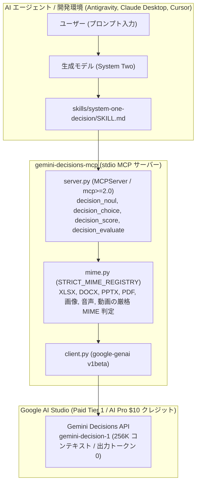

# gemini-decisions-mcp

[English](./README.md) | **日本語**

**Google Gemini Decisions API (`gemini-decision-1`)** を MCP（Model Context Protocol）サーバー、Agent Skill、および Python ツールキットとして使えるようにした公開リポジトリです。**出力トークン 0（Zero Output Tokens）**・超低遅延・厳格なマルチモーダル MIME 判定を実現します。

---

## Gemini Decisions API (`gemini-decision-1`) とは？

従来のテキスト生成型 LLM を「ルーティング」「分類」「リスク判定」「仕様チェック」に使うと、1トークンずつ生成するため遅く、出力トークン課金が発生し、JSON パースエラーや自信過剰（キャリブレーションの狂い）が起きがちでした。

`gemini-decision-1` は **System One（直感的・高速な決定専用モデル）** として動作します：

- **Zero Output Tokens（出力トークン 0）**: テキスト生成を行わず直接確率値（Calibrated Probabilities）を算出するため、**出力料金は完全無料（\$0）**。
- **超低遅延（公称 150〜250 ms / 日本実測 ~180〜400 ms）**: 有料枠（Paid Tier 1）利用時、好条件時は **中央値 186〜218 ms**、Google 側バックエンド混雑・経路変動時を含めても **約 200〜400 ms 帯**（Keep-Alive 時の通信＋ローカル処理は **約 11 ms**）。
- **256K コンテキスト（最大 262,144 トークン）**: ソースコード一式や長大な PDF 仕様書をそのまま投入可能。
- **最大 1,000 問の並列バッチ評価**: 1 リクエストで `noul`（Yes/No）・`choice`（2〜255 択）・`score`（ルーブリック採点）を一斉判定。
- **厳格な MIME 判定によるフルマルチモーダル対応**: `.xlsx`, `.xls`, `.csv`, `.ods`, `.docx`, `.pptx`, `.pdf`, 画像, 音声, 動画を `application/octet-stream` による無言の誤判定なしに直接処理。
- **ローカル GPU/RAM 不要**: 常駐 10GB 超のローカル推論サーバーを不要にし、オンデマンド起動の軽量 stdio MCP（~30〜50 MB）で完結。

---

## 公式ドキュメント・関連リンク

| 資料・ページ | URL |
| :--- | :--- |
| **Gemini Decisions API 公式ドキュメント** | https://aistudio.google.com/docs/decisions-api |
| **Gemini Decision 1 モデル仕様 (`gemini-decision-1`)** | https://aistudio.google.com/docs/models/gemini-decision-1 |
| **Google 公式発表ブログ（Gemini Decisions API）** | https://blog.google/innovation-and-ai/technology/developers-tools/gemini-decisions-api/ |
| **Google AI Pro の \$10 クレジットを AI Studio で使う公式ガイド** | https://aistudio.google.com/learn/use-google-ai-plan-credits-in-ai-studio |
| **Google 公式ブログ（Google Developer Program & AI Studio クレジット）** | https://blog.google/innovation-and-ai/technology/developers-tools/google-cloud-credits-gdp-ai-studio/ |
| **Google Developer Program 特典受け取りページ（My Benefits）** | https://me.developers.google.com/benefits |
| **Google Developer Program 特典ヘルプ** | https://developers.google.com/profile/help/benefits |
| **Google AI Studio / API キー取得画面** | https://aistudio.google.com/apikey |
| **Google GenAI Python SDK (`google-genai>=3.2.0`)** | https://github.com/googleapis/python-genai |
| **自律プレイ検証のベースリポジトリ（TypeSafe Mario）** | https://github.com/fhshaik/typesafe-mario |

---

## Google AI Pro \$10枠の獲得・課金設定・API キー取得ガイド

**Google AI Pro** を契約している場合、Google Developer Program 特典として **毎月 \$10 分の Google Cloud / AI Studio クレジット** が付与されます。`gemini-decision-1` は出力トークン料金が \$0 のため、月 \$10 枠があれば **約 1 億入力トークン分** を実質追加コストなしで運用できます。

初回セットアップでハマりやすいポイントを含め、以下の手順で進めてください。

### 手順 1: Google AI Pro 特典（毎月 \$10 クレジット）の獲得と紐付け
1. Google AI Pro 契約中の Google アカウントで [Google Developer Program 特典ページ（My Benefits）](https://me.developers.google.com/benefits)（または Google AI Studio 内のクレジット設定画面）へアクセスします。
2. 毎月の **\$10 分デベロッパークレジット** を有効化し、Google Cloud の**請求先アカウント（Billing Account）** に紐付けます。
   - **注意点**: クレジットは毎月リセットされ、翌月への繰越はできません。また契約者本人のアカウントのみが対象です（詳細は [特典ヘルプ](https://developers.google.com/profile/help/benefits) と [AI Studio 公式ガイド](https://aistudio.google.com/learn/use-google-ai-plan-credits-in-ai-studio) を参照）。

### 手順 2: 有料枠（Paid Tier 1）と Prepay（事前チャージ）ロック解除の重要注意点
1. **無料枠（Free Tier）との速度差**:
   - 無料枠は共有キューのため、遅延の増大やスロットリングが発生しやすくなります。
   - 請求先アカウントを紐付けた有料プロジェクト（**Paid Tier 1**）にするとスロットリングを回避でき、日本国内からでも **約 180〜400 ms 帯**（好条件時 中央値 186〜218 ms、サーバー側経路・負荷に応じて変動）で高速に動作します。
2. **Prepay ロックの罠と解除方法（`402 RESOURCE_EXHAUSTED`）**:
   - Cloud クレジット（\$10 枠など）を保有していても、Google AI Studio 側の Prepay（前払い）残高が **\$0 / ¥0** のままだと、`402 RESOURCE_EXHAUSTED`（`Your prepayment credits are depleted`）エラーが発生する場合があります。
   - **解除方法**: 最低チャージ額（例: **\$5** または **¥800**）を一度チャージするとロックが解除されます。解除後の実際の API 利用料は **保有している \$10 クレジット枠が最優先で自動消費** されるため、チャージ残高は実質的に温存されます。

### 手順 3: API キーの取得と環境変数設定
1. [Google AI Studio API キー取得画面](https://aistudio.google.com/apikey) にアクセスします。
2. 上記の請求先アカウント（\$10 クレジット適用済み）がリンクされたプロジェクトを選択し、**「API キーを作成」** をクリックします。
3. 取得したキーを `.env` または環境変数に設定します：
   ```bash
   cp .env.example .env
   # .env を編集して GEMINI_API_KEY=あなたのキー を記載
   ```
   またはシェルで直接エクスポートします：
   ```bash
   export GEMINI_API_KEY="あなたのキー"
   ```

---

## システム構成



---

## 提供 MCP ツール

標準の `decision_*` に加え、既存スキルとの互換性のために `jev_*` エイリアスもデフォルトで登録されます（`--no-legacy-aliases` を指定すると `decision_*` のみを登録します）。

| ツール名（標準 / 互換） | プリミティブ | 用途と返却値 |
| :--- | :--- | :--- |
| **`decision_noul`** / `jev_noul` | 二値判定 (Yes/No) | キャリブレーション済み確率 `probability`（`0.0`〜`1.0`）、`is_likely`、`confidence`、`latency_ms`、`usage`（`output_tokens: 0`）を返却。 |
| **`decision_choice`** / `jev_choice` | 多肢選択 (2〜255 択) | 選択された `choice`、`confidence`、全候補の確率分布 `probabilities`、`latency_ms`、`usage` を返却。 |
| **`decision_score`** / `jev_score` | ルーブリック採点 (2〜255 段階) | 確率加重の期待値 `score`、`confidence`、`legend`、`probabilities`、`latency_ms`、`usage` を返却。 |
| **`decision_evaluate`** / `jev_evaluate` | 並列バッチ評価 (最大 1,000 問) | 同一のマルチモーダル `state` に対し複数種類の質問を 1 パスで一括評価し、`answers`・`latency_ms`・`usage` を返却。 |

すべてのツールで、引数 `state` に**ローカルファイルパス、テキスト、JSON オブジェクト、およびそれらの混在配列**を直接渡せます。

---

## 厳格な MIME 判定エンジン (`STRICT_MIME_REGISTRY`)

Office 文書やメディアファイルを Decisions API に渡す際、MIME タイプが `application/octet-stream` や誤った形式になると、エラーを出さずにモデルが誤判定する現象が起きやすくなります。

`mime.py` では拡張子から Google GenAI 仕様に完全一致する MIME タイプを静的マッピングし、未対応のバイナリ拡張子は `ToolError` として明示的に拒否します。

- **表計算・データ**: `.xlsx`, `.xls`, `.csv`, `.ods`
- **文書・プレゼン**: `.pdf`, `.docx`, `.doc`, `.dotx`, `.odt`, `.pptx`, `.ppt`, `.odp`
- **画像**: `.png`, `.jpg`, `.jpeg`, `.webp`, `.gif`, `.bmp`, `.heic`, `.heif`, `.tiff`, `.tif`
- **音声**: `.wav`, `.mp3`, `.m4a`, `.flac`, `.aac`, `.ogg`, `.opus`, `.aiff`, `.aif`
- **動画**: `.mp4`, `.webm`, `.mov`, `.avi`, `.wmv`, `.mpeg`, `.mpg`, `.3gp`
- **テキスト・コード**: `.txt`, `.md`, `.json`, `.tsv`, `.yaml`, `.yml`, `.toml`, `.py`, `.ts`, `.js`, `.rs`, `.go`, `.sql` 等

---

## インストールと MCP 設定方法

### `uv` でのセットアップ（推奨）

```bash
git clone https://github.com/osamuraiegg/gemini-decisions-mcp.git
cd gemini-decisions-mcp
uv sync
```

起動確認：
```bash
uv run gemini-decisions-mcp --help
```

### Antigravity / MCP クライアントへの登録

[templates/mcp_config.json](./templates/mcp_config.json) を参考に、お使いの `mcp_config.json`（例: `~/.gemini/config/mcp_config.json`）へ追加します：

```json
{
  "mcpServers": {
    "gemini-decisions": {
      "command": "uv",
      "args": [
        "run",
        "--directory",
        "/path/to/gemini-decisions-mcp",
        "gemini-decisions-mcp"
      ],
      "env": {
        "GEMINI_API_KEY": "${GEMINI_API_KEY}"
      }
    }
  }
}
```

### Agent Skill・Global Rules の導入（サンプル／カスタマイズ可）

[skills/system-one-decision/SKILL.md](./skills/system-one-decision/SKILL.md) と [templates/GEMINI.md](./templates/GEMINI.md) は**汎用的なサンプルテンプレート**として同梱しています。プロジェクトやご自身の運用ルールに合わせて、判定閾値・チェック項目・ワークフローを自由に書き換えてご利用ください：

- [skills/system-one-decision/SKILL.md](./skills/system-one-decision/SKILL.md) を `~/.gemini/config/skills/system-one-decision/SKILL.md`（またはプロジェクトの `.agents/skills/system-one-decision/SKILL.md`）へコピーして必要に応じて編集。
- 必要に応じて [templates/GEMINI.md](./templates/GEMINI.md) の内容を Global Rules（`~/.gemini/config/GEMINI.md` や `AGENTS.md`）へ追記。

### Antigravity チャットからの動作確認手順

> [!TIP]
> GUI 環境で `GEMINI_API_KEY` が未エクスポートのまま `mcp_config.json` に `"${GEMINI_API_KEY}"` が書かれていても、本サーバーは未展開プレースホルダーを自動検知して `.env`（または `~/.gemini/config/.env`）へフォールバックします。
> なお、`mcp_config.json` を編集した後は **Antigravity の MCP サーバーを再読み込み（または新しいチャットを開始）** してください。

1. **最小疎通チェック（`decision_noul` + レイテンシ / 出力トークン 0 確認）**:
   ```text
   gemini-decisions MCP サーバーの decision_noul を使って、
   「本番環境で --force 付き git push main を実行するのは危険か？」を判定し、
   probability・latency_ms・output_tokens をそのまま見せてください。
   ```
   期待結果: `is_likely: true`（`probability` 約 `0.99`）、`output_tokens: 0`、および `latency_ms` が返ります。

2. **同梱フィクスチャを使った 2 段階仕様書レビュー確認（`decision_evaluate`）**:
   ```text
   examples/fixtures/sample_spec.md と examples/fixtures/sample_impl.py を比較して、
   system-one-decision スキル（2段階レビュー）で整合性を厳密にチェックしてください。
   ```
   期待結果: Stage 1 で定数不一致（`REQUEST_TIMEOUT_SECONDS` 30秒 vs 15秒）・引数差分（`dry_run`）・未記載例外（`InvalidCurrencyError`）を検出し、Stage 2 で修正用 Markdown 差分が提示されます。

3. **エラーログ分類の確認（`decision_choice`）**:
   ```text
   「ConnectionRefusedError: 127.0.0.1:5432」を gemini-decisions MCP を使って
   [network, database, auth, ui] に分類し、確率分布も表示してください。
   ```

> 既存の `gemini-decisions` 設定を残したまま検証したい場合は、`mcp_config.json` に別名（例: `"gemini-decisions-dev"`）で併記してテストすることもできます。

---

## 実践ワークフローとサンプルコード (`examples/`)

### 1. クイックスタート（`noul` + `choice` + `score` 並列判定）
```bash
uv run python examples/01_quickstart.py
```

### 2. Excel (`.xlsx`) データ直接監査（`STRICT_MIME_REGISTRY`）
個人情報を含まないダミーの顧客健全性 `.xlsx` を一時生成し、バイナリのまま解約リスクを判定します：
```bash
uv run --extra examples python examples/02_excel_audit.py
```

### 3. 仕様書 vs コードの 2 段階ハイブリッド・レビュー（Pattern G）
Decisions API の客観性と生成モデルの説明力を組み合わせた実践パターンです：
- **第 1 段階（`gemini-decision-1`）**: `decision_evaluate` で定数一致・API シグネチャ網羅・例外定義・完成度を 1 パスで一斉判定。
  - $P \ge 0.8$: 合格（`PASS`）
  - $P \le 0.2$: 明確な乖離・不整合（`FAIL`）
  - $0.2 < P < 0.8$: 記載漏れ・解釈揺れ（`NEEDS_REVIEW`）
- **第 2 段階（生成モデル）**: `FAIL` / `NEEDS_REVIEW` 項目に対し、該当行の対比と修正後の Markdown 差分を作成。

```bash
uv run python examples/03_spec_review_2stage.py
```

### 4. 複数質問アンサンブルによる安全制御（`choice` + `noul` + `score`）
スーパーマリオ自律プレイ検証（[fhshaik/typesafe-mario](https://github.com/fhshaik/typesafe-mario) を `gemini-decision-1` へ移植した検証）から確立したパターンです。
行動選択（`choice`）と同時に、独立した安全確認用の二値判定（`noul`: `jump_needed`）と危険度（`score`: `danger`）を 1 パスで取得し、`jump_needed > 0.5` または `danger >= 1.0` の場合に受動的な行動を安全な回避行動へオーバーライドします。

```bash
uv run python examples/04_ensemble_safety_gate.py
```

---

## 実機ベンチマーク（日本国内回線 / Paid Tier 1）

### 好条件時のベースライン実測
| 入力・判定内容 | 試行回数 | 中央値 (Latency) | p95 (95%タイル) | 出力トークン |
| :--- | :---: | :---: | :---: | :---: |
| 短文・1 判定 | 30 | **200 ms** | 316 ms | 0 |
| 日本語会話・3 判定 | 30 | **186 ms** | 229 ms | 0 |
| 会話履歴 2,573 トークン・3 判定 | 20 | **218 ms** | 333 ms | 0 |

### Keep-Alive と Google サーバー側処理時間（`Server-Timing`）の内訳実測
ローカル/通信オーバーヘッドと Google バックエンド処理時間を切り分けるため、ウォーム連続 10 回および Keep-Alive 有無（各 5 回）を Google Front End の HTTP `Server-Timing` ヘッダ（計測指標名 `gfet4t7`）で比較・実測した結果です：

| 計測項目 | 最小 | 中央値 | 最大 | 備考 |
| :--- | :---: | :---: | :---: | :--- |
| **通信 RTT + ローカル SDK** (Keep-Alive ON) | 10.2 ms | **11.3 ms** | 19.3 ms | 毎回切断すると TLS 再接続で `31.4〜36.2 ms` に増加 |
| **Google サーバー側 (`Server-Timing`)** | 238.0 ms | **371.5 ms** | 525.0 ms | バックエンド経路・混雑度で変動（全体の約 97%） |
| **全体 (`total` / ウォーム 10 回)** | 322.1 ms | **384.8 ms** | 535.7 ms | 5回比較では Keep-Alive 中央値 `374.2 ms` / 毎回切断 `383.4 ms` |

- **ポイント**: `DecisionsClient` は API キー単位で `genai.Client` をキャッシュし、MCP サーバー稼働中（Antigravity 等を開いている間）は HTTP Keep-Alive により通信オーバーヘッドを **約 11 ms** に維持します（アプリ終了・MCP 再起動で自動切断）。全体の 200〜400 ms 帯の揺らぎは Google 側の 1 リクエストごとの振り分け・負荷によるものです。

---

## 開発・テスト

```bash
uv run --extra dev pytest -v
uv run --extra dev ruff check src tests examples
```

---

## ライセンス

[MIT License](./LICENSE) — Copyright (c) 2026 osamuraiegg
