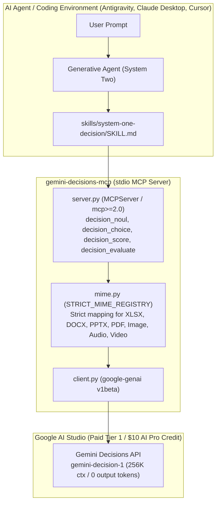

# gemini-decisions-mcp

**English** | [日本語](./README.ja.md)

An MCP (Model Context Protocol) server, Agent Skill, and Python toolkit for **Google Gemini Decisions API (`gemini-decision-1`)** — built for ultra-low-latency, calibrated, **zero-output-token** multimodal judgments.

---

## Why Gemini Decisions API (`gemini-decision-1`)?

Traditional generative LLMs are suboptimal for routing, classification, compliance gates, and rubric checks: they generate tokens sequentially (slow), incur output token fees, require fragile JSON parsing, and often emit poorly calibrated confidence scores.

`gemini-decision-1` acts as a **System One** decision engine:

- **Zero Output Tokens (`output_tokens = 0`)**: Evaluates probabilities directly in a single forward pass with **$0 output token cost**.
- **Ultra-Low Latency (~150–250 ms spec; ~180–400 ms from Japan)**: Measured at **186–218 ms median** in optimal Paid Tier 1 runs (typically **200–400 ms** depending on Google backend `gfet4t7` routing/load, with **~11 ms** local + edge RTT via HTTP keep-alive).
- **256K Shared Context (262,144 tokens)**: Feed entire source files, long PDF specs, or multi-file comparisons at once.
- **Up to 1,000 Parallel Questions**: Evaluate `noul` (Yes/No), `choice` (2–255 options), and `score` (ordered rubric) simultaneously in one request.
- **Full Multimodal Input with Strict MIME Dispatching**: Natively handles `.xlsx`, `.xls`, `.csv`, `.ods`, `.docx`, `.pptx`, `.pdf`, images, audio, and video without silent `application/octet-stream` degradation.
- **Zero Local GPU/RAM Footprint**: Replaces heavy local decision servers (~10 GB+ RAM/VRAM) with an on-demand stdio MCP server (~30–50 MB RAM).

---

## Official Documentation & Related Links

| Resource | URL |
| :--- | :--- |
| **Gemini Decisions API Docs** | https://aistudio.google.com/docs/decisions-api |
| **Gemini Decision 1 Model Spec (`gemini-decision-1`)** | https://aistudio.google.com/docs/models/gemini-decision-1 |
| **Google Official Announcement Blog (Decisions API)** | https://blog.google/innovation-and-ai/technology/developers-tools/gemini-decisions-api/ |
| **Guide: Use Google AI Plan Credits in AI Studio** | https://aistudio.google.com/learn/use-google-ai-plan-credits-in-ai-studio |
| **Google Blog: Developer Program & AI Studio Credits** | https://blog.google/innovation-and-ai/technology/developers-tools/google-cloud-credits-gdp-ai-studio/ |
| **Google Developer Program — My Benefits** | https://me.developers.google.com/benefits |
| **Google Developer Program Benefits Help** | https://developers.google.com/profile/help/benefits |
| **Google AI Studio — API Keys** | https://aistudio.google.com/apikey |
| **Google GenAI Python SDK (`google-genai>=3.2.0`)** | https://github.com/googleapis/python-genai |
| **Autonomous Play Base Repo (`typesafe-mario`)** | https://github.com/fhshaik/typesafe-mario |

---

## Google AI Pro ($10/mo Credit), Prepay Unlock & API Key Guide

If you subscribe to **Google AI Pro**, you receive **$10/month in Google Cloud / AI Studio developer credits** — more than enough for roughly **100 million input tokens per month** on `gemini-decision-1` (since output tokens cost $0).

Follow these steps to avoid the most common setup pitfalls:

### Step 1: Claim & Link Your Monthly $10 Credit
1. Sign in with the Google account that holds your **Google AI Pro** subscription and open [Google Developer Program — My Benefits](https://me.developers.google.com/benefits) (or the billing/credits panel inside Google AI Studio).
2. Activate your monthly **$10 developer credit** and link it to a Google Cloud **Billing Account**.
   - *Note*: Credits reset monthly, do not roll over to the next month, and apply only to the subscribing account (see [Benefits Help](https://developers.google.com/profile/help/benefits) and the [official credit guide](https://aistudio.google.com/learn/use-google-ai-plan-credits-in-ai-studio)).

### Step 2: Paid Tier 1 & the Prepay `$0` Lock Pitfall
1. **Free Tier vs. Paid Tier 1 Latency**:
   - The Free Tier uses a shared queue and is prone to throttling and latency spikes.
   - Upgrading the project to **Paid Tier 1** (by linking your Billing Account) avoids Free Tier throttling and achieves **~180–400 ms** end-to-end latency from Japan (186–218 ms median in optimal runs; higher when Google backend routing/load fluctuates).
2. **The Prepay `$0` Lock Trap (`402 RESOURCE_EXHAUSTED`)**:
   - Even when you have active Cloud Credits ($10/mo), Google AI Studio may temporarily reject API calls with `402 RESOURCE_EXHAUSTED` (`Your prepayment credits are depleted`) if your AI Studio **Prepay balance is $0 / ¥0**.
   - **How to unlock**: Make the minimum Prepay top-up (e.g., **$5** or **¥800**). Once unlocked, **your $10 monthly Google Cloud Credits are consumed first automatically**, leaving your prepaid top-up balance untouched until credits are exhausted.

### Step 3: Create & Configure Your API Key
1. Open [Google AI Studio API Keys](https://aistudio.google.com/apikey).
2. Select the Google Cloud project linked to your Billing Account (with the $10 credit applied) and click **Create API key**.
3. Configure `GEMINI_API_KEY`:
   ```bash
   cp .env.example .env
   # Edit .env and set GEMINI_API_KEY=your-key
   ```
   Or export it in your shell:
   ```bash
   export GEMINI_API_KEY="your-key"
   ```

---

## Architecture



---

## MCP Tools

Both primary (`decision_*`) and backward-compatible (`jev_*`) tool names are registered by default. Pass `--no-legacy-aliases` to register only `decision_*`.

| Tool (Primary / Alias) | Primitive | Purpose & Return Value |
| :--- | :--- | :--- |
| **`decision_noul`** / `jev_noul` | Binary (Yes/No) | Returns calibrated `probability` (`0.0`–`1.0`), `is_likely`, `confidence`, `latency_ms`, and `usage` (`output_tokens: 0`). |
| **`decision_choice`** / `jev_choice` | Multi-choice (2–255) | Selects best `choice`, `confidence`, full `probabilities` distribution, `latency_ms`, and `usage`. |
| **`decision_score`** / `jev_score` | Ordered Rubric (2–255) | Returns weighted float `score`, `confidence`, `legend`, `probabilities`, `latency_ms`, and `usage`. |
| **`decision_evaluate`** / `jev_evaluate` | Parallel Batch (up to 1,000) | Evaluates multiple typed questions over a shared multimodal `state` in one pass, returning `answers`, `latency_ms`, and `usage`. |

All tools accept a file path, plain text, JSON dict, or mixed list of paths and strings in `state`.

---

## Strict MIME Engine (`STRICT_MIME_REGISTRY`)

When sending Office documents or binary media to `gemini-decision-1`, ambiguous MIME types such as `application/octet-stream` can cause silent misclassifications without throwing an error.

`mime.py` enforces exact MIME mappings by extension and rejects unknown binary formats with an explicit `ToolError`:

- **Spreadsheets & Data**: `.xlsx`, `.xls`, `.csv`, `.ods`
- **Documents & Presentations**: `.pdf`, `.docx`, `.doc`, `.dotx`, `.odt`, `.pptx`, `.ppt`, `.odp`
- **Images**: `.png`, `.jpg`, `.jpeg`, `.webp`, `.gif`, `.bmp`, `.heic`, `.heif`, `.tiff`, `.tif`
- **Audio**: `.wav`, `.mp3`, `.m4a`, `.flac`, `.aac`, `.ogg`, `.opus`, `.aiff`, `.aif`
- **Video**: `.mp4`, `.webm`, `.mov`, `.avi`, `.wmv`, `.mpeg`, `.mpg`, `.3gp`
- **Source & Text**: `.txt`, `.md`, `.json`, `.tsv`, `.yaml`, `.yml`, `.toml`, `.py`, `.ts`, `.js`, `.rs`, `.go`, `.sql`, etc.

---

## Installation & MCP Client Configuration

### Run directly with `uv` (Recommended)

```bash
git clone https://github.com/osamuraiegg/gemini-decisions-mcp.git
cd gemini-decisions-mcp
uv sync
```

Verify CLI startup:
```bash
uv run gemini-decisions-mcp --help
```

### Configure in Antigravity / MCP Clients

Copy [templates/mcp_config.json](./templates/mcp_config.json) into your MCP configuration (e.g. `~/.gemini/config/mcp_config.json`):

```json
{
  "mcpServers": {
    "gemini-decisions": {
      "command": "uv",
      "args": [
        "run",
        "--directory",
        "/path/to/gemini-decisions-mcp",
        "gemini-decisions-mcp"
      ],
      "env": {
        "GEMINI_API_KEY": "${GEMINI_API_KEY}"
      }
    }
  }
}
```

### Install the Sample Agent Skill & Global Rules (Optional / Customizable)

`skills/system-one-decision/SKILL.md` and `templates/GEMINI.md` are **starter samples** designed for general-purpose agent workflows. Feel free to edit the probability thresholds, checklists, and patterns to match your own project conventions:

- Copy [skills/system-one-decision/SKILL.md](./skills/system-one-decision/SKILL.md) to `~/.gemini/config/skills/system-one-decision/SKILL.md` (or `.agents/skills/system-one-decision/SKILL.md`) and customize as needed.
- Optionally merge [templates/GEMINI.md](./templates/GEMINI.md) into your Global Rules (`~/.gemini/config/GEMINI.md` or `AGENTS.md`).

### Verifying from Antigravity Chat

> [!TIP]
> If `GEMINI_API_KEY` is stored in `.env` (or `~/.gemini/config/.env`) and not exported in your GUI environment, `"${GEMINI_API_KEY}"` in `mcp_config.json` is automatically treated as unset and falls back to `.env`.
> After editing `mcp_config.json`, **reload MCP servers or open a new chat** so Antigravity picks up the changes.

1. **Smoke test (`decision_noul` + latency & zero output tokens check)**:
   ```text
   Use gemini-decisions MCP's decision_noul to judge whether running `git push --force main` in production is dangerous, and show the returned probability, latency_ms, and output_tokens.
   ```
   Expected result: `is_likely: true` (`probability` ~`0.99`), `output_tokens: 0`, and `latency_ms` reported.

2. **2-Stage Hybrid Specification Review using bundled fixtures (`decision_evaluate`)**:
   ```text
   Compare examples/fixtures/sample_spec.md and examples/fixtures/sample_impl.py using the system-one-decision skill (2-stage review) and report any mismatches.
   ```
   Expected result: Stage 1 flags the constant mismatch (`REQUEST_TIMEOUT_SECONDS` 30 vs 15), signature drift (`dry_run`), and undocumented `InvalidCurrencyError`, and Stage 2 produces concrete review comments and a corrected Markdown diff.

3. **Error triage (`decision_choice`)**:
   ```text
   Use gemini-decisions MCP to classify "ConnectionRefusedError: 127.0.0.1:5432" into [network, database, auth, ui] and show the full probability distribution.
   ```

> To test changes side-by-side without replacing an existing `gemini-decisions` entry, register a second temporary server name (e.g. `"gemini-decisions-dev"`) in `mcp_config.json`.

---

## Key Workflows & Runnable Examples

### 1. Quickstart (`noul` + `choice` + `score` in parallel)
```bash
uv run python examples/01_quickstart.py
```

### 2. Direct Excel (`.xlsx`) Audit (`STRICT_MIME_REGISTRY`)
Generates a synthetic customer health workbook (no real PII) and evaluates churn risk directly from the binary `.xlsx` file:
```bash
uv run --extra examples python examples/02_excel_audit.py
```

### 3. 2-Stage Hybrid Specification Review (Pattern G)
Combines System One objectivity with System Two reasoning:
- **Stage 1 (`gemini-decision-1`)**: Scans constants, API signatures, exceptions, and completeness in a single `decision_evaluate` pass.
  - $P \ge 0.8$: `PASS`
  - $P \le 0.2$: Discrepancy (`FAIL`)
  - $0.2 < P < 0.8$: Ambiguity / Needs Review (`NEEDS_REVIEW`)
- **Stage 2 (Generative Agent)**: Produces line-by-line review comments and corrected Markdown diffs for `FAIL` / `NEEDS_REVIEW` findings.

```bash
uv run python examples/03_spec_review_2stage.py
```

### 4. Multi-Question Safety Ensemble (`choice` + `noul` + `score`)
Learned from autonomous Super Mario Bros. experiments ([fhshaik/typesafe-mario](https://github.com/fhshaik/typesafe-mario) adapted to `gemini-decision-1`):
Evaluating a primary `choice` alongside an independent binary `noul` hazard check (`jump_needed`) and a `danger` `score` in a single request enables deterministic safety overrides when `jump_needed > 0.5` or `danger >= 1.0`.

```bash
uv run python examples/04_ensemble_safety_gate.py
```

---

## Measured Benchmarks (Japan Network, Paid Tier 1)

### Optimal Runs (Baseline)
| Workload | Samples | Median Latency | p95 Latency | Output Tokens |
| :--- | :---: | :---: | :---: | :---: |
| Short text / 1 question | 30 | **200 ms** | 316 ms | 0 |
| Japanese conversation / 3 questions | 30 | **186 ms** | 229 ms | 0 |
| 2,573-token history / 3 questions | 20 | **218 ms** | 333 ms | 0 |

### Keep-Alive & Server-Timing (`gfet4t7`) Breakdown
To isolate local/network overhead from Google's backend processing, 10 consecutive warm calls + a 5-vs-5 keep-alive test were measured via `Server-Timing: gfet4t7`:

| Metric | Min | Median | Max | Notes |
| :--- | :---: | :---: | :---: | :--- |
| **Network RTT + Local SDK** (Keep-Alive ON) | 10.2 ms | **11.3 ms** | 19.3 ms | Fresh TLS without keep-alive adds ~20–40 ms (`31.4–36.2 ms`) |
| **Google Server-Side (`gfet4t7`)** | 238.0 ms | **371.5 ms** | 525.0 ms | Varies with Google backend routing & cluster load (~97% of total) |
| **End-to-End Total** (10 warm calls) | 322.1 ms | **384.8 ms** | 535.7 ms | Keep-Alive median `374.2 ms` vs Fresh Conn `383.4 ms` (5-call check) |

- **Takeaway**: `DecisionsClient` caches `genai.Client` per API key so the connection stays warm (`~11 ms` network+local overhead) while the MCP server is running (closing the host app closes the stdio server cleanly). Any fluctuation between ~200 ms and ~400+ ms reflects Google's per-request backend routing/load (`gfet4t7`).

---

## Development & Testing

```bash
uv run --extra dev pytest -v
uv run --extra dev ruff check src tests examples
```

---

## License

[MIT License](./LICENSE) — Copyright (c) 2026 osamuraiegg
