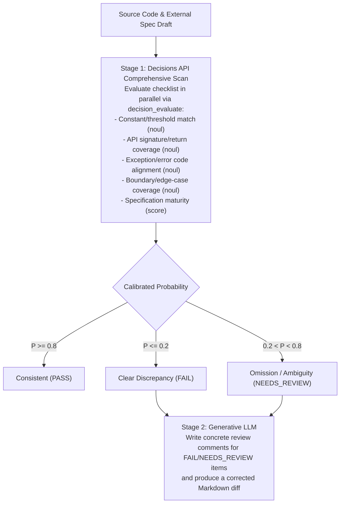

# System One Decision (Google Gemini Decisions API / gemini-decision-1)

This skill guides the agent in leveraging the **Google Gemini Decisions API (`gemini-decision-1`)** via the `gemini-decisions` MCP server to perform high-speed, calibrated, zero-output-token judgments.

Unlike generative LLMs that produce free-form text, `gemini-decision-1` evaluates a document, data sheet, or multimodal state against structured questions in a single forward pass, returning exact probability distributions and scores with ultra-low latency (~150-250ms official spec; ~180-400ms from Japan on Paid Tier 1). It supports up to **262,144 tokens (256K)** of shared context and can evaluate up to **1,000 independent questions** in parallel with **zero output token charges**.

Supported inputs include:
- Plain text, source code diffs, logs, and JSON.
- **Spreadsheets & Data**: Excel (`.xlsx`, `.xls`), `.csv`, `.ods`.
- **Office Documents**: Word (`.docx`, `.doc`), PowerPoint (`.pptx`, `.ppt`).
- **Documents & Media**: PDF (`.pdf`), images (`.png`, `.jpg`, `.webp`), audio (`.wav`, `.mp3`, `.m4a`), and video (`.mp4`, `.webm`).

---

## When to Use

Activate this skill when:
- **Specification & Document Review (2-Stage Review)**: Conducting a rigorous, objective audit of external specifications, design docs, or requirements against source code.
- **Office / Tabular Data Evaluation**: Auditing Excel spreadsheets (`.xlsx`) or CSVs directly for customer churn risk, revenue anomalies, or KPI conditions.
- **Triage & Classification**: Deciding which component, service, or architectural layer a bug or task belongs to (`choice`).
- **Action Gating**: Assessing the risk of a proposed edit, command, or file deletion before applying it (`noul`).
- **Rubric Scoring**: Objectively rating code cleanliness, security risk, or implementation complexity across defined levels (`score`).
- **Specification & Implementation Auditing**: Systematically checking whether requirements, evaluation sheets, or design docs match actual source code constants, state transitions, or APIs.
- **Test Result Judgment & Report Generation**: Evaluating test logs, traces, or execution outputs to classify results into `PASS`, `FAIL`, or `NEEDS_REVIEW`, and compiling structured evaluation reports (Markdown, JSON, CSV).
- **Multimodal Visual & Media Audit**: Auditing screenshots, UI layouts, diagrams, audio recordings, or video evidence by passing file paths directly in `state`.
- **Parallel Decisions**: Answering multiple independent categorical and probability questions over the same context in a single request.

---

## Exposed MCP Tools (`gemini-decisions`)

All tools communicate with `gemini-decision-1` via the `gemini-decisions` MCP server. Both `decision_*` (primary) and `jev_*` (backward-compatible alias) tool names are available by default:

### 1. `decision_noul` / `jev_noul` (Binary / Yes-No Probability)
Use for confidence gating and binary hypothesis checks. Returns a calibrated probability ($0.0 \le P \le 1.0$) and `is_likely` ($P \ge 0.5$).

**When to call:**
- "Does this change introduce high regression risk?"
- "Do the requirement specifications and source code implementation match?"
- "Are there customers at high risk of churn in this spreadsheet?"
- "Did this test run satisfy the expected state transition?"

**Parameters:**
- `state`: File path (`.xlsx`, `.pdf`, `.png`, etc.), code block, log output, or comparison text.
- `instructions`: The specific yes/no question to evaluate.
- `criteria` (optional): `{"true": "Explanation of yes condition", "false": "Explanation of no condition"}`.

---

### 2. `decision_choice` / `jev_choice` (Categorical Classification)
Selects one option from a defined set of 2 to 255 choices, returning the selected choice, confidence score, and full probability distribution.

**When to call:**
- Routing an error to a root cause category (e.g. `network`, `database`, `auth`, `ui`).
- Classifying test items by domain/subsystem.
- Determining task type (e.g. `bug_fix`, `feature`, `refactor`, `documentation`).

**Parameters:**
- `state`: File path, text, or structured context to evaluate.
- `instructions`: What decision to make.
- `criteria`: A key-value dictionary mapping choices to descriptive definitions.

---

### 3. `decision_score` / `jev_score` (Rubric-based Rating)
Rates input along an ordered rubric of at least two descriptive levels. Returns a weighted float score and confidence.

**When to call:**
- Scoring change severity (e.g. `["Low", "Medium", "High", "Critical"]`).
- Assessing code complexity (e.g. `["Trivial", "Moderate", "Complex", "Architectural"]`).
- Confidence scoring for fuzzy test results (e.g. `["Clear Fail", "Borderline / Flaky", "Clear Pass"]`).

**Parameters:**
- `state`: File path, code, diff, log, or plan.
- `instructions`: Evaluation prompt.
- `criteria`: Ordered array of level labels (from lowest to highest).

---

### 4. `decision_evaluate` / `jev_evaluate` (Parallel Multi-Question Evaluation)
Evaluates up to 1,000 typed questions (`noul`, `choice`, `score`) simultaneously against the same state in a single round-trip.

---

## Workflow Patterns

### Pattern A: Pre-Flight Action Gate
Before modifying critical files or running irreversible commands:
1. Extract the proposed action / diff as `state`.
2. Call `decision_noul` with `instructions: "Is this action dangerous or likely to cause unexpected side effects?"`.
3. If `probability >= 0.6`:
   - Pause or create a safe backup / dry-run.
   - Explain the risk to the user.
4. If `probability < 0.6`:
   - Proceed automatically.

---

### Pattern B: Error & Bug Triage
When diagnosing an issue:
1. Provide the stack trace or bug report as `state`.
2. Call `decision_choice` with candidate root causes in `criteria`.
3. Use the highest-probability branch to focus investigation.

---

### Pattern C: Specification Conformance & Discrepancy Audit
Audit requirements or design docs against source code and test scripts:
1. Pass the specification and implementation pair as `state`.
2. Call `decision_noul` with `instructions: "Does the implementation satisfy the specification without value discrepancies or behavioral contradictions?"`.
3. Branch based on probability:
   - $P \ge 0.8$: Consistent (`PASS`)
   - $P \le 0.2$: **Discrepancy Detected (`FAIL`)** -> List discrepancies as warnings.
   - $0.2 < P < 0.8$: Ambiguity / Potential Risk (`NEEDS_REVIEW`) -> Highlight for human review.

---

### Pattern D: Test Output Judgment & Report Generation
Evaluate test execution logs or traces into `PASS` / `FAIL` / `NEEDS_REVIEW`:
- **`PASS`**: `probability >= 0.8`
- **`FAIL`**: `probability <= 0.2`
- **`NEEDS_REVIEW`**: `0.2 < probability < 0.8`

---

### Pattern E: Multimodal Media Audit (PDF / Images / Audio / Video)
Pass file paths directly into `state` (e.g., `state: "docs/spec.pdf"` or `state: ["screenshots/ui.png", "tokens.json"]`).
The MCP server automatically detects MIME types and uploads binary data via Google GenAI SDK.

---

### Pattern F: Tabular & Office Data Audit (Excel `.xlsx` / CSV)
Evaluate business conditions or anomalies directly against spreadsheet files:
1. Pass the `.xlsx` file path directly as `state`:
   `state: "data/churn_analysis.xlsx"`
2. Call `decision_noul`:
   - `instructions: "Are there customers in this sheet with high churn risk?"`
3. The MCP server ensures the strict MIME type `application/vnd.openxmlformats-officedocument.spreadsheetml.sheet` is used, preventing `octet-stream` errors and silent misclassifications.

---

### Pattern G: External Specification 2-Stage Hybrid Review
Standard protocol when reviewing external specifications or design documents against source code:

#### Execution Steps:
1. **Combine inputs**: Pass source files and the specification draft as an array or structured text in `state`.
2. **Parallel scan via `decision_evaluate`**:
   - `q_constants`: "Do constant values (timeouts, retry limits, buffer sizes) in the code match the specification?" (`noul`)
   - `q_api_coverage`: "Are all public function signatures, arguments, return types, and status codes documented in the specification?" (`noul`)
   - `q_exceptions`: "Are implemented exception paths and error codes accurately described in the specification?" (`noul`)
   - `q_maturity`: "Specification completeness level" (`score`: `["Initial draft", "Structured but incomplete", "Review ready"]`)
3. **Author actionable review comments**:
   For every item with $P \le 0.2$ (`FAIL`) or $0.2 < P < 0.8$ (`NEEDS_REVIEW`), have the generative agent explain the exact line-by-line mismatch and output a copy-pasteable Markdown diff.

---

### Pattern H: Multi-Question Safety Ensemble (`choice` + `noul` + `score`)
For high-stakes or real-time control decisions (such as production action guards or autonomous agent control):
1. Combine a primary `choice` question with an independent binary `noul` safety check (e.g., `safety_override_needed`, `requires_confirmation`, or `jump_needed`) and a `score` (`danger` / `severity`) in a single `decision_evaluate` call.
2. Apply a deterministic guard: if the binary `noul` probability exceeds `0.5` or the `score` crosses your safety threshold, override passive/risky choices with the safe fallback action.
